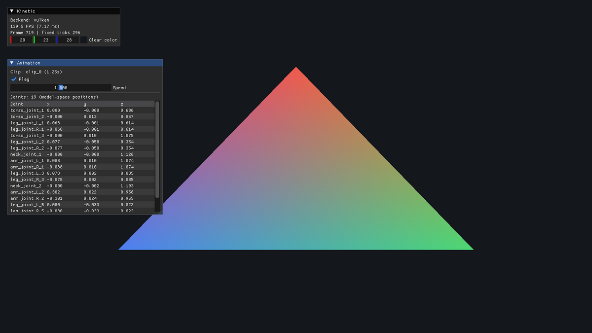

# Kinetic Engine

A cross-platform (macOS + Windows) 3D engine written in C++20, built around **character animation**:
skeletal playback, blending, IK and — the long-term goal — physics-driven procedural animation
in the spirit of NaturalMotion's Euphoria.



## Status

Milestone 1 — foundations:

- [x] CMake + presets, dependencies pinned via CPM (nothing to install by hand)
- [x] SDL3 window + SDL_GPU device (Metal on macOS, Vulkan on Windows)
- [x] Test triangle, Dear ImGui (docking), editor shell with dockable panels
- [x] Fixed-timestep main loop
- [x] Animation core: SoA poses, clip sampling, blending, additive layers, local → model → skinning matrices
- [x] glTF skeleton + animation import (cgltf)
- [x] Unit tests (doctest) + CI on macOS and Windows

See the [roadmap](#roadmap) for what comes next.

## Building

Requirements: **CMake ≥ 3.25**, **Ninja**, and a C++20 compiler —
Xcode command line tools on macOS, Visual Studio 2022 (MSVC) on Windows.
On Windows you also need a GPU driver with Vulkan support (any recent NVIDIA / AMD / Intel driver).

```bash
cmake --preset debug          # first run downloads dependencies into .cpm-cache/
cmake --build --preset debug
ctest --preset debug          # unit tests
./build/debug/bin/sandbox     # Windows: build\debug\bin\sandbox.exe
```

**CLion:** open the folder — CLion picks up `CMakePresets.json` automatically. Enable the
`debug` / `release` profiles in *Settings → Build, Execution, Deployment → CMake* and run the
`sandbox` or `kinetic_editor` configuration. On Windows choose the *Visual Studio* toolchain.

Useful flags: `--frames N` (quit after N frames), `--gpu-debug` (GPU validation in release builds).

### Shaders

Shaders are written in GLSL (`shaders/src`) and committed pre-compiled to SPIR-V (Vulkan) and
MSL (Metal) in `shaders/compiled`, so a normal build needs no shader tools. After editing a shader:

```bash
python3 tools/compile_shaders.py   # needs glslangValidator + spirv-cross (Vulkan SDK)
```

## Layout

```
engine/
  core/        logging, asserts, types, clock
  animation/   Skeleton, Pose (SoA), AnimationClip, blending, skinning math   ← no SDL / GPU code
  assets/      glTF import
  scene/       ECS (EnTT) + components
  platform/    SDL3 window and input
  gfx/         SDL_GPU device, shaders, frames
  renderer/    passes and draw code
  ui/          Dear ImGui integration
  app/         Application base class + main loop
sandbox/       feature playground
editor/        dockable tool UI
shaders/       GLSL sources + compiled SPIR-V / MSL
tests/         unit tests
tools/         scripts (shader compiler)
```

Design notes: [docs/ARCHITECTURE.md](docs/ARCHITECTURE.md).

## Roadmap

1. ~~Window, triangle, ImGui, CI~~
2. Camera, depth buffer, mesh rendering from glTF, offscreen viewport in the editor
3. Debug draw (lines, skeletons, gizmos)
4. GPU skinning
5. Blend trees + animation state machine
6. IK (two-bone, FABRIK), foot placement
7. Physics (Jolt): ragdolls, then an active ragdoll driven by motors — the Euphoria-style layer
8. DXIL shaders via SDL_shadercross (D3D12 on Windows)

## Third-party

SDL3, Dear ImGui, glm, spdlog, EnTT, cgltf, doctest (all fetched by CPM).
Sample model credits: [assets/models/CREDITS.md](assets/models/CREDITS.md).

## License

MIT — see [LICENSE](LICENSE).
